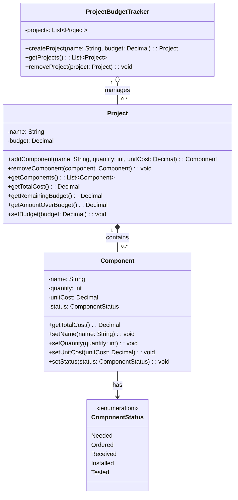

# IAP M3 — AI Domain Model First Draft

## Prompt Given to the AI

Read the M2 requirements in REQUIREMENTS.md for my Engineering Project Component & Budget Tracker.

Draft a domain model for the application as a Mermaid class diagram. Include the proposed classes, important attributes, operations, relationships, and multiplicities.

Generate the model independently from the M2 requirements. Do not modify any project files, do not critique the model, and do not revise it. This must be the original first draft.

## Original AI Response

Optimized tool selectionI’ll read the M2 section in `REQUIREMENTS.md` and derive a first-pass Mermaid class diagram directly from those requirements, without changing any project files.

Read 

